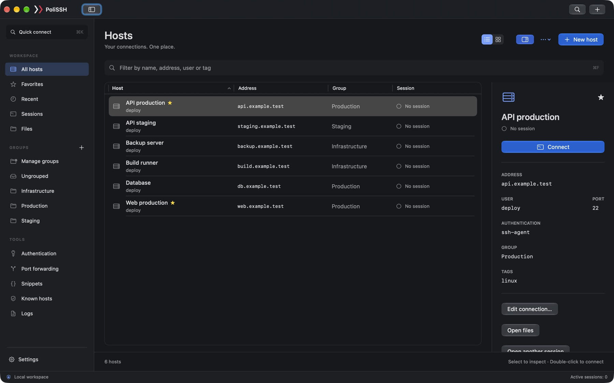

# PoliSSH

SSH terminals, SFTP and remote editing for macOS. Local terminals, split panes and reusable commands in one app.

[Pobierz / Download 0.22.0](https://github.com/AlmostSensible/PoliSSH-docs/releases/download/v0.22.0/PoliSSH-0.22.0-arm64.zip){ .md-button .md-button--primary }
[Instrukcja PL](pl/guide.md){ .md-button }
[User guide EN](en/guide.md){ .md-button }

**Public beta · Apple Silicon (M1 or later) · macOS 14+ · ZIP, 12.8 MB**

**Publiczna beta · Apple Silicon (M1 lub nowszy) · macOS 14+**

Signed with Developer ID and notarized by Apple. Intel Macs are not supported by this download. Core SSH, SFTP and local terminals do not require an AI account or developer tools. Optional AI providers have their own requirements.

Podpis Developer ID i notaryzacja Apple. Paczka nie obsługuje Maców z procesorem Intel. SSH, SFTP i lokalny terminal nie wymagają konta AI ani narzędzi programistycznych. Opcjonalni dostawcy AI mają własne wymagania.

## Connect, work, transfer / Połączenia, terminal, pliki

- **SSH:** saved hosts, authentication profiles, fingerprint approval, jump hosts and tunnels. Zapisane hosty, profile, potwierdzanie odcisków, hosty pośredniczące i tunele.
- **Terminal:** local and remote sessions, split panes, snippets and reviewed AI suggestions. Sesje lokalne i zdalne, podział paneli, polecenia i sugestie AI do sprawdzenia przed użyciem.
- **SFTP:** file/folder transfers, conflict handling and UTF-8 remote editing. Transfery plików i katalogów, rozstrzyganie konfliktów i edycja UTF-8.

## Install / Instalacja

1. Download and extract the ZIP. Pobierz i rozpakuj ZIP.
2. Move **PoliSSH.app** to **Applications / Aplikacje**. Quit an older copy before replacing it. Przed zastąpieniem zamknij poprzednią wersję.
3. Open the app from Applications. Follow the [first connection guide](en/guide.md#first-connection) / [instrukcję pierwszego połączenia](pl/guide.md).
4. Later updates: **PoliSSH → Check for Updates… / Sprawdź aktualizacje…**. Finish active sessions and transfers before installing.

## Before using the beta / Przed użyciem bety

Keep backups of important files. Interrupted SFTP writes can leave partial destination files, including editor saves. iCloud synchronization is experimental: it has not yet been verified between two Macs. Minimum macOS 14 compatibility still needs a test on a separate Mac; current integration tests run on a newer macOS.

Zachowaj kopie ważnych plików. Przerwany zapis SFTP, również z edytora, może zostawić częściowy plik docelowy. Synchronizacja iCloud jest eksperymentalna — nie została jeszcze sprawdzona między dwoma Macami. Deklarowane minimum macOS 14 wymaga jeszcze próby na osobnym Macu; bieżące testy integracyjne działają na nowszym systemie.

[Release notes / Historia zmian](releases.md) · [Availability and limitations / Ograniczenia](status.md) · [Prywatność](pl/privacy.md) · [Privacy](en/privacy.md) · [Pomoc](pl/support.md) · [Support](en/support.md) · [Third-party licenses / Licencje bibliotek](licenses.md)

**AlmostSensible** · [hello@almostsensible.com](mailto:hello@almostsensible.com)
